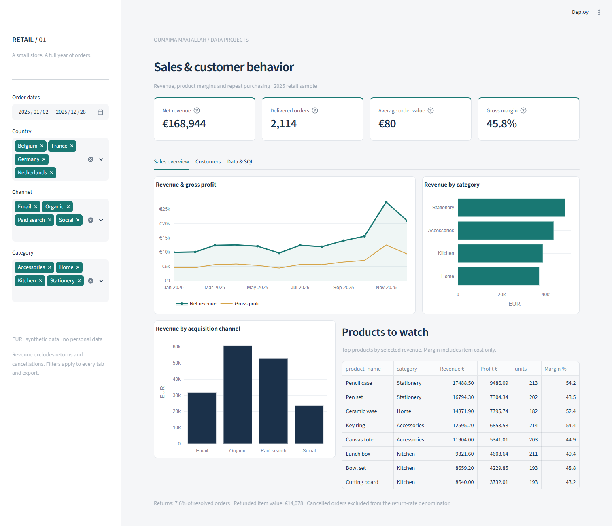

# E-commerce sales analysis

A retail dashboard for sales trends, product margins and repeat purchasing. Python and SQLite prepare the data; Streamlit and Plotly display it.



## Run

Requires **Python 3.11–3.13**. From this folder:

```sh
python run.py
```

This creates `.venv`, installs the pinned dependencies and starts the app at **http://localhost:8501**. Internet is needed for the first install. On systems where Python is named `python3`, use that instead.

```sh
python run.py --test       # metric and dashboard tests
python run.py --export     # CSV tables and summary.json in exports/
```

## Try it

Filter to Germany and Email, compare product margins, then open the customer cohorts. Download the selected order lines to check the numbers yourself. A category filter measures spending on that category within each order.

The included data is **synthetic**: 2,400 orders in 2025, generated with seed 42. It is not client work or evidence of a business outcome. All amounts are EUR; returns and cancellations produce no revenue.

[Setup, Docker and dependencies](docs/setup.md) · [Data and metric definitions](docs/model.md) · [Power BI import](docs/power-bi.md)
